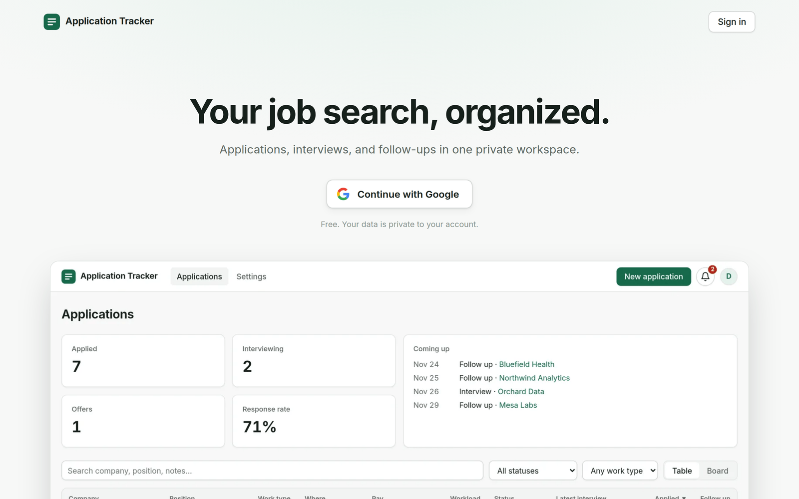
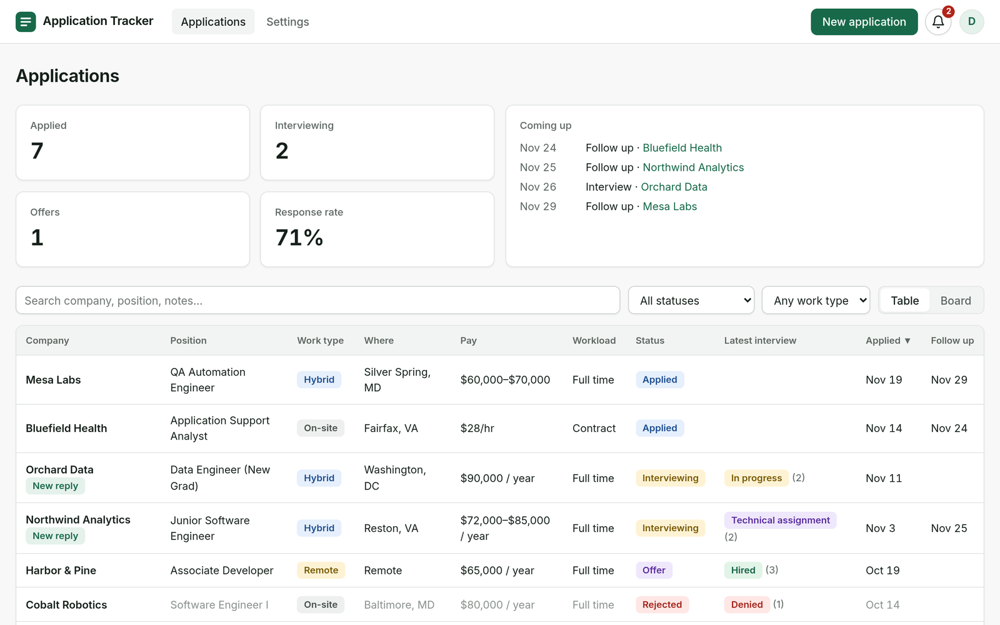
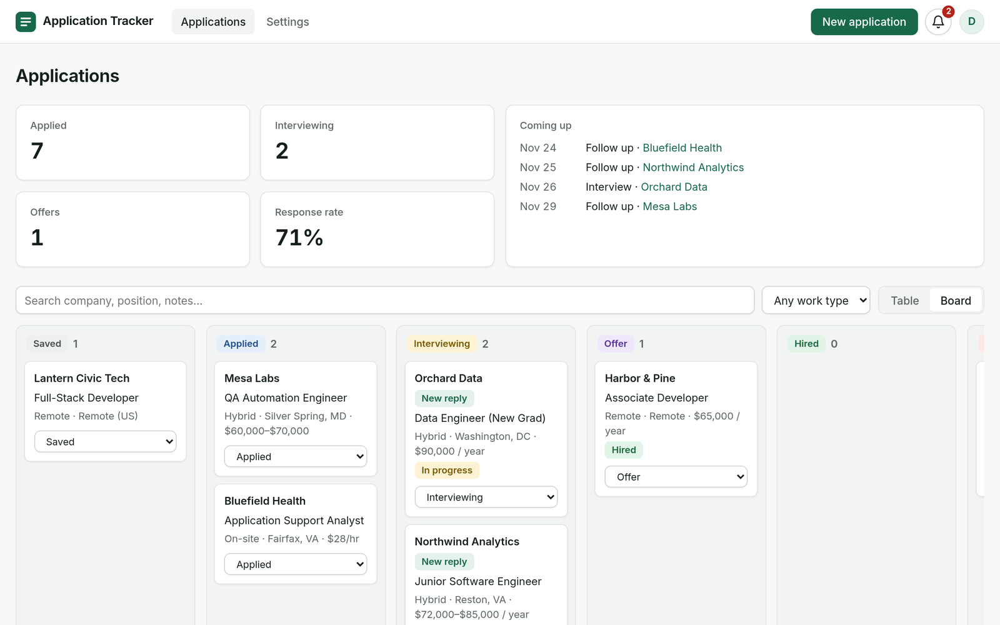
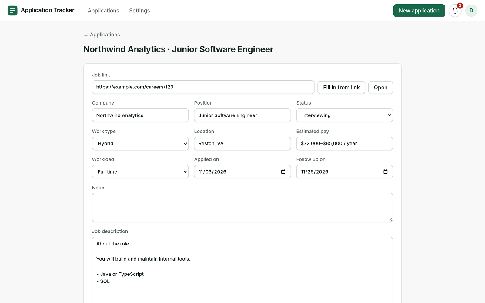
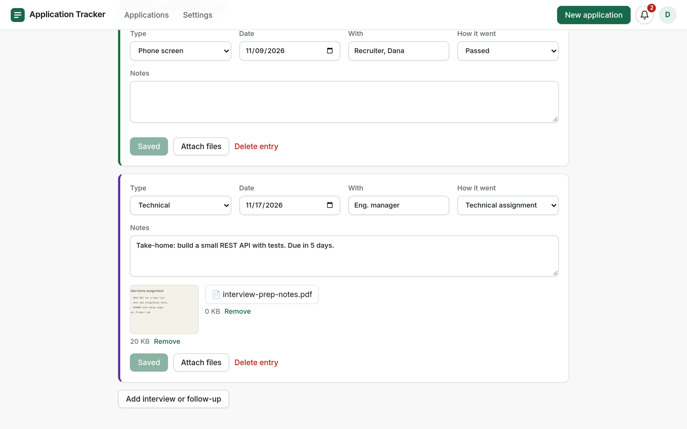
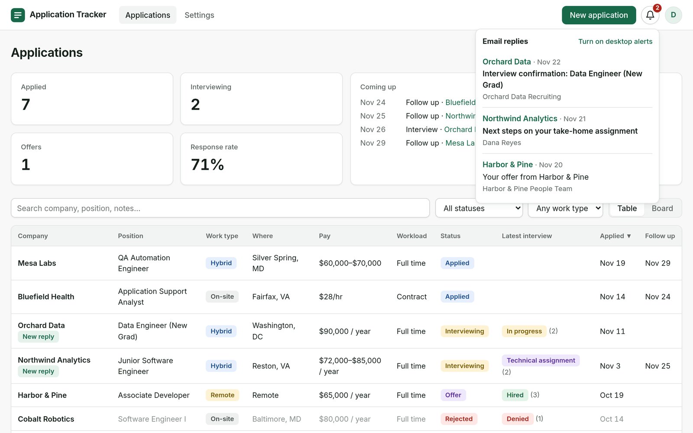
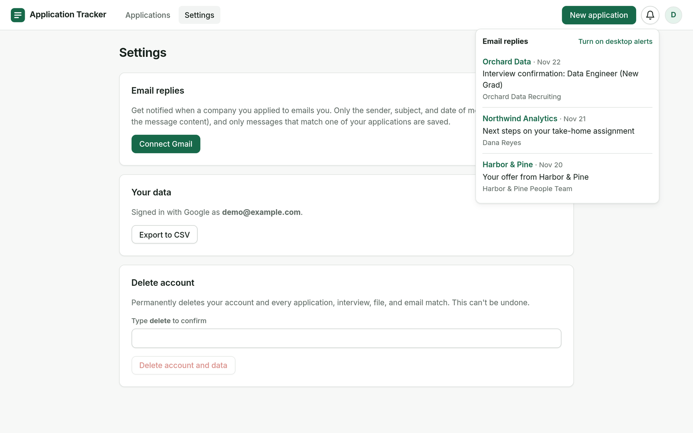

# Application Tracker

A job application tracker that anyone can sign in to with their Google account. Live at **https://applicationtracker.tech**.

I tracked my own job search in a Google Sheet (company, position, work type, pay, interview 1–3 results, feedback). This app does the same job with a few things a spreadsheet can't do well:

- **Fill in from a link.** Paste a job posting URL and the company, title, location, pay, workload, and full description are filled in (from the page's `JobPosting` structured data, Greenhouse's public job API, or OpenGraph tags as a fallback).
- **The job description is saved with the application**, so it's still there after the posting is taken down.
- **An interview timeline per application.** Log any number of interviews and follow-ups (type, date, who, how it went, notes), each with screenshots or PDFs attached.
- **Table and board views.** Sort and filter like a spreadsheet, or drag cards between status columns. Statuses are color-coded.
- **Email reply alerts (optional).** Connect Gmail and the app watches for messages from companies you applied to, marks the application "New reply", and shows a notification (in-app, and as a desktop alert if you allow it). It reads only message headers, never message content.
- **Stats and reminders.** Applied, interviewing, offers, response rate, and a list of upcoming follow-ups and interviews (overdue ones in red).
- **Your data stays yours.** Every query is scoped to the signed-in user. You can export everything to CSV, or delete your account, which removes all of your rows and files right away.



| Table | Board |
|---|---|
|  |  |

| Application details | Interview timeline with attachments |
|---|---|
|  |  |

| Email reply notifications | Settings |
|---|---|
|  |  |

Dark mode follows the system setting: [screenshot](docs/table-dark.png). Screenshots use made-up sample data.

## Stack

| Part | Choice | Why |
|---|---|---|
| Server | Node.js 26 + [Fastify](https://fastify.dev) in TypeScript | Node runs the `.ts` files directly (type stripping), so there's no server build step. The container uses ~55 MB of RAM. |
| Database | PostgreSQL 17, plain SQL via `pg` | Ownership rules are enforced with foreign keys, not only in code (see below). |
| Frontend | React 19 + Vite | A static bundle with no inline scripts or styles, so the CSP doesn't need `unsafe-inline`. |
| Images | [sharp](https://sharp.pixelplumbing.com) | Re-encodes uploaded images, which removes EXIF/GPS data. |
| Hosting | Docker Compose on a small VPS behind Caddy | Caddy handles HTTPS certificates and security headers. The app is bound to `127.0.0.1` only. |

Runtime dependencies: `fastify`, `@fastify/cookie`, `@fastify/multipart`, `@fastify/rate-limit`, `@fastify/static`, `pg`, `sharp`. Google sign-in, sessions, the SSRF-safe fetcher, the HTML/JSON-LD parser, and CSV export are written directly against Node's standard library.

## Architecture

```
Browser ──HTTPS──► Caddy (TLS, CSP + security headers, access log)
                     │  reverse_proxy 127.0.0.1:8082
                     ▼
               ┌─────────────── docker compose ───────────────┐
               │  app (Node/Fastify, read-only FS, non-root)  │
               │    ├─ /auth/*   Google OpenID Connect        │
               │    ├─ /api/*    JSON API (session required)  │
               │    └─ /*        built React app              │
               │        │                     │               │
               │  db (PostgreSQL)      uploads volume         │
               │  no published port    /data/uploads/<user>/  │
               └──────────────────────────────────────────────┘
                     ▲
     cron 03:30 ─ backup.sh: pg_dump + uploads tarball, kept 14 days
```

```
server/
  main.ts        reads env, runs migrations, starts the server
  app.ts         all routes, CSRF check, error handling, CSV export
  auth.ts        Google sign-in (OIDC code flow + PKCE) and sessions
  autofill.ts    SSRF-safe page fetcher + JobPosting / OpenGraph / Greenhouse parsers
  uploads.ts     content sniffing, EXIF stripping, filename cleanup
  gmail.ts       optional Gmail connection: OAuth, encrypted refresh tokens, inbox scan, email → company matching
  db.ts          connection pool + tiny migration runner
  migrations/    SQL schema
web/src/         React app (Overview = table/board/stats, Detail = form + timeline)
web/public/      privacy.html, terms.html (plain HTML so they work without JS)
test/            node:test suites
```

## Security design

This app stores strangers' data, so these are the decisions that matter:

**Sign-in and sessions**
- Google OpenID Connect authorization-code flow with **PKCE, `state`, and `nonce`**. The ID token is received directly from Google's token endpoint over TLS, then `iss`, `aud`, `exp`, `nonce`, and `email_verified` are checked ([OIDC Core 3.1.3.7](https://openid.net/specs/openid-connect-core-1_0.html#IDTokenValidation)). Only the `openid email profile` scopes are requested. Google access tokens are never stored.
- Sessions are 256-bit random tokens in a `__Host-session` cookie (`Secure`, `HttpOnly`, `SameSite=Lax`, host-only). The database stores only their **SHA-256 hash**. Signing out deletes the session server-side.

**Every query is scoped to the user**
- Every SQL statement under `/api` includes `user_id = $current_user`. Missing and not-yours both return `404`, so IDs can't be probed.
- The database enforces this too. `events` and `attachments` carry `user_id` with **composite foreign keys** (`(application_id, user_id) → applications(id, user_id)`), so a row can never point at another user's parent even if a query had a bug. Account deletion cascades through all tables.
- `test/api.test.ts` creates two users and checks that user B gets `404` on every read, update, delete, upload, and download of user A's application, interview, and file, and that A's data is unchanged afterwards.

**CSRF:** cookies are `SameSite=Lax`, and every non-GET request must carry an `Origin` header equal to the app's origin; otherwise it gets `403`.

**Auto-fill fetcher (SSRF)**
- Only `http`/`https` on ports 80/443, with no credentials in the URL.
- Hostnames are resolved and **every** resolved address must be public. Loopback, RFC 1918, CGNAT, link-local (including `169.254.169.254` cloud metadata), multicast, reserved, IPv6 ULA/link-local, NAT64, and IPv4-mapped forms are blocked. The check runs inside the socket's own DNS `lookup`, so the address that was checked is the one connected to (no DNS-rebinding window). IP literals are checked before connecting.
- At most 3 redirects, each re-validated. 2 MB response limit, 8 s total timeout. Only HTML (or JSON from Greenhouse's API) is parsed. It is rate-limited to 15 requests a minute.
- LinkedIn, Indeed, Glassdoor, and ZipRecruiter are not fetched (their terms forbid it). The user is asked to paste the description instead.

**Uploads**
- The type is decided by the file's **magic bytes**, never the name or the browser's `Content-Type`. Only PNG, JPEG, WebP, and PDF are accepted, with 10 MB per file and 200 MB per user.
- Images are decoded and **re-encoded** with sharp. That removes EXIF/GPS metadata and anything appended to the file, and a pixel limit guards against decompression bombs.
- Files are stored outside the web root at `/data/uploads/<user-id>/<uuid>` (mode `0600`), never under their original names. They are served only through `/api/attachments/:id` after an ownership check, with `Content-Security-Policy: default-src 'none'; sandbox`, `nosniff`, and `Cache-Control: private, no-store`. PDFs are always served as downloads.

**Gmail access (optional, per user)**
- Normal sign-in asks only for `openid email profile`. Gmail is a separate, opt-in step ("Connect Gmail" in Settings) using incremental authorization, so users who don't connect it never see a Gmail permission.
- The narrowest Gmail scope that works is used: `gmail.metadata`, which gives message headers (From, Subject, date) but no bodies or attachments, and no ability to send or change mail.
- The callback checks that Google actually granted the Gmail scope (users can untick it) and that the ID token's `sub` matches the signed-in user, so only your own mailbox can be connected.
- The refresh token is encrypted with **AES-256-GCM** using `TOKEN_KEY`, which lives only in the server's root-only env file. Database dumps and backups don't contain the key.
- Only matching messages are stored (sender, subject, date, Gmail message ID). Everything else is discarded right after comparison. Disconnecting, or deleting the account, revokes the token with Google and deletes all stored matches. If Google reports the token was revoked (`invalid_grant`), the connection is removed automatically.
- Matching: the sender's domain must be the company's (`northwindanalytics.com`, `acmecorp.com`; free-mail domains never count), or the full company name must appear in the sender name or subject (for recruiting-system mail such as Greenhouse or Workday). `test/gmail.test.ts` covers both directions, including near-miss domains that must not match.

**Headers, transport, and containers**
- Caddy serves HTTPS only (HSTS) with `default-src 'self'; script-src 'self'; style-src 'self'; frame-ancestors 'none'; object-src 'none'`, plus `nosniff`, `Referrer-Policy`, and `Permissions-Policy`.
- Rate limits: 300 requests/min per IP overall, 20/min for sign-in, 30/min for uploads, and 15/min for auto-fill.
- Input is validated with JSON schemas (lengths, enums, dates). Links must start with `http(s)://`, so a saved link can't become a `javascript:` URL.
- CSV export prefixes cells that start with `= + - @` to block spreadsheet formula injection.
- Containers: the app is non-root with a read-only filesystem, `cap_drop: ALL`, `no-new-privileges`, and memory limits. Postgres has no published port, and the app port is bound to `127.0.0.1`.
- Secrets (database password, Google client secret) live only on the server in root-only files under `/etc/application-tracker/`. Nothing secret is in this repo.

**Known limits:** backups are on the same server (no off-site copy yet). The Gmail feature uses a Google "restricted" scope, so until the app completes Google's verification and security assessment, users see an "unverified app" screen when connecting Gmail, and Google caps it at 100 users. PDFs are stored as uploaded (their metadata isn't stripped). Rate limits are in memory, which is fine for one instance.

## Running locally

Requires Node 26+ and Docker (for Postgres).

```bash
docker run -d --name tracker-pg -e POSTGRES_PASSWORD=dev -e POSTGRES_DB=tracker -p 127.0.0.1:5432:5432 postgres:17-alpine
npm install
export PGHOST=127.0.0.1 PGUSER=postgres PGPASSWORD=dev PGDATABASE=tracker
npm run build && npm start          # http://localhost:3000
```

Signing in with Google locally needs your own OAuth client (`GOOGLE_CLIENT_ID`, `GOOGLE_CLIENT_SECRET`, and `APP_ORIGIN=http://localhost:3000` with redirect URI `http://localhost:3000/auth/google/callback`). To try the app without Google, `node scripts/demo-data.ts` adds sample data for a demo user and prints a session token (instructions are at the top of the script).

For frontend work, run `npm run dev` (API with auto-restart) and `npm run dev:web` (Vite on :5173, proxying `/api` and `/auth`).

## Tests

```bash
npm test          # needs the PG* variables above; the API tests wipe that database
npm run typecheck
```

- `test/api.test.ts`: cross-user isolation for every endpoint (including email notifications), the database-level ownership constraint, 401/403 for missing sessions and cross-site requests, input validation, upload content checks, CSV formula escaping, and account deletion removing every row and file.
- `test/autofill.test.ts`: JSON-LD parsing (entity-encoded HTML, `@graph`, salary ranges, remote jobs), OpenGraph fallback, Greenhouse API mapping, the blocked-address list, URL rules, and refusal of hostnames that resolve to private addresses.
- `test/gmail.test.ts`: email → company matching (company domains, recruiting-system mail, free-mail and near-miss domains that must not match) and token encryption round-trip and tamper detection.
- `test/uploads.test.ts`: magic-byte detection, EXIF removal, rejection of disguised and corrupt files, the size limit, and filename cleanup.

CI (GitHub Actions) runs the typecheck, all tests against a PostgreSQL service container, the frontend build, and the production Docker build.

## Deploying

`./deploy.sh` builds the image locally, copies it to the server, creates the database password on first run, installs the nightly backup cron job, and starts the containers. The Caddy site block lives in the portfolio repo's Caddyfile.

Google credentials are added once on the server, without ever passing through chat or the repo:

```bash
ssh -t braydon@179.66.159.71 'read -rp "Client ID: " id; read -rsp "Client secret: " s; echo; printf "GOOGLE_CLIENT_ID=%s\nGOOGLE_CLIENT_SECRET=%s\n" "$id" "$s" | sudo sh -c "umask 077; cat > /etc/application-tracker/google.env" && cd /opt/application-tracker && sudo docker compose up -d'
```

Restore from a backup:

```bash
sudo docker compose exec -T db pg_restore -U tracker -d tracker --clean < /var/backups/application-tracker/db-YYYY-MM-DD.dump
sudo docker compose exec -T app tar -C /data -xz < /var/backups/application-tracker/uploads-YYYY-MM-DD.tar.gz
```

## License

MIT
